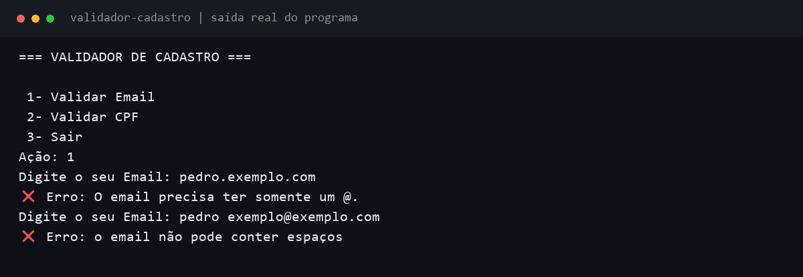

# Validador de Cadastro em Python

Projeto de estudo para praticar regras básicas de formato de e-mail e cálculo dos dígitos verificadores de CPF, com interação pelo terminal.

**Python 3 · Terminal · Projeto educativo**



*A imagem mostra duas rejeições da versão atual, com entradas fictícias. A saída real foi diagramada para facilitar a leitura.*

## O que estou praticando

- Entrada e saída com `input()` e `print()`.
- Condições, repetições e operadores lógicos.
- Manipulação de strings e conversão de tipos.
- Verificação do formato de e-mails.
- Cálculo de dígitos verificadores com pesos e resto da divisão.

## Como executar

É necessário ter **Python 3** instalado. Baixe os arquivos, abra o terminal na pasta do projeto e execute:

```bash
python main.py
```

O menu oferece as opções `1` para e-mail, `2` para CPF e `3` para sair. Na versão atual, a opção escolhida se repete; para interromper uma sessão de validação, use `Ctrl+C`.

## Estado atual e próximos ajustes

A implementação está em revisão. Antes de usá-la para validar cadastros, os próximos ajustes são:

- Corrigir a condição de pontos consecutivos, que atualmente rejeita e-mails com domínio preenchido.
- Ajustar a verificação de usuário e domínio vazios.
- Corrigir a atribuição do segundo dígito verificador do CPF.
- Reapresentar o menu após cada validação e tratar entradas não numéricas.

## Limitações

Este projeto tem finalidade educativa e ainda não é indicado para validações em produção.

- A verificação de formato não confirma que uma caixa de e-mail existe.
- O cálculo de CPF não consulta a Receita Federal nem confirma existência, titularidade ou situação cadastral.
- As falhas listadas acima precisam ser corrigidas para que as verificações funcionem como previsto.

Use dados fictícios em demonstrações e não publique informações pessoais no repositório.
